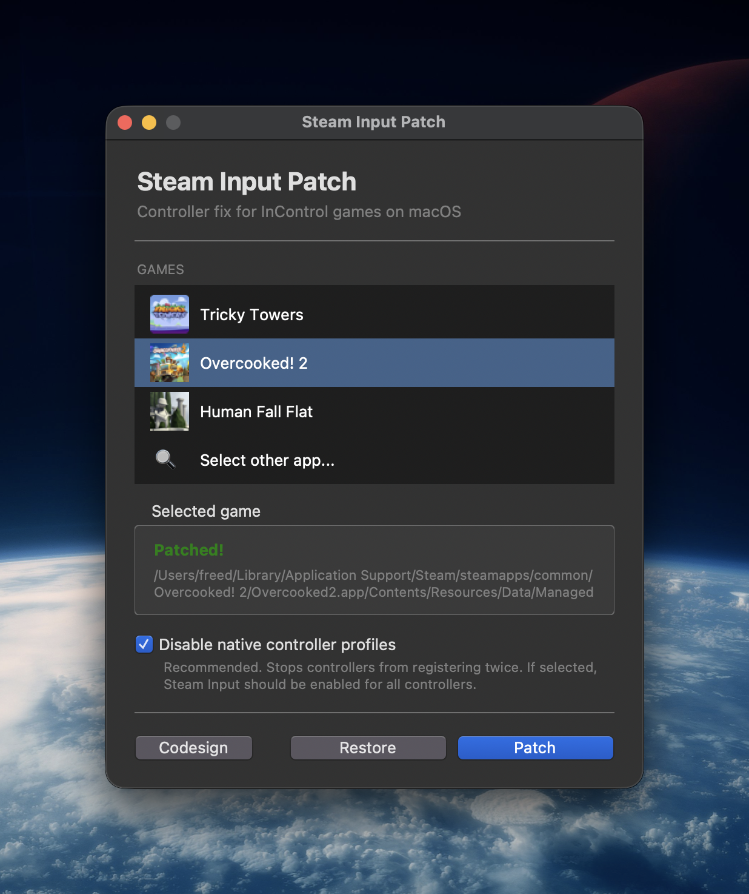

# Steam Input Controller Patch for InControl Games (macOS)

[](https://github.com/fr-eed/macos-incontrol-controller-patch/releases)
[](https://buymeacoffee.com/zerofreed)

Fixes controller support on macOS by patching games to recognize Steam Input's virtual controllers.

> [!TIP]
> **[Download the latest release](https://github.com/fr-eed/macos-incontrol-controller-patch/releases/latest)** and run the patcher app. No Python required.

<p align="center"></p>

## Supported Games

- Tricky Towers
- Overcooked! 2
- Human Fall Flat
- Any other Unity game that used InControl package

## Problem

These games use InControl for input handling. On macOS, Steam Input presents controllers as "Microsoft GamePad-1", "Microsoft GamePad-2", etc. These names don't match any built-in InControl profile, causing controllers to appear as "Unknown Device".

## Solution

Patches `Assembly-CSharp.dll` to replace Xbox360MacProfile's JoystickNames with Steam Input controller names:

| Original | Replacement |
|----------|-------------|
| Microsoft Wireless 360 Controller | Microsoft GamePad-1 |
| Mad Catz, Inc. Mad Catz FPS Pro GamePad | Microsoft GamePad-2 |
| Mad Catz, Inc. MadCatz Call of Duty GamePad | Microsoft GamePad-3 |
| ©Microsoft Corporation Controller | Microsoft GamePad-4 |

### Disable native controller profiles

It is recommended to use all controllers through steam input as some controllers can be registered twice by the game which causes double inputs. 

tick "Disable native controller profiles" in the GUI (or use `--disable-native-profiles`). This will null out all profile names except Steam input controllers, basically disabling any controller that doesn't go through Steam input

To undo, untick it and click Patch again.

### Bluetooth DualShock 4 mode (Human Fall Flat)

Two problems stop DualShock 4 controllers from working in Human Fall Flat local co-op:

- Over Bluetooth, macOS switches a DS4 to its extended input report (`0x11`). InControl can only read the basic report (`0x01`), so the controller is detected but does nothing.
- Through Steam Input, every virtual pad has the same HID Location ID (`0x0`), so with two controllers their inputs overwrite each other. One player is blocked while the other moves.

Tick "Bluetooth DualShock 4 mode" in the GUI (or use `--ds4-bluetooth`), and **disable** Steam Input for the game. This mode:

- replaces the game's `InControlNative` plugin with [`native/InControlNative.c`](native/InControlNative.c), which decodes DS4 reports over Bluetooth and USB itself and gives every controller its own device;
- patches `Assembly-CSharp.dll` so InControl uses native input.

The original plugin is kept as `InControlNative.orig`, and Restore puts back both files. The Steam Input patch isn't used in this mode. This mode is only for Human Fall Flat, and other games are rejected. The plugin also lives as a standalone app in [ds4-bluetooth-fix-mac](https://github.com/TheNils96/ds4-bluetooth-fix-mac).

To build the plugin when running from source: `sh native/build.sh` (needs the Xcode command line tools).

## Usage

### GUI (recommended)

```bash
python3 patch_gui.py
```

Automatically detects supported games in the default Steam library folder; games installed in other Steam library locations must be selected or provided manually.

### Command Line

```bash
python3 patch.py                        # Patch all installed games
python3 patch.py /path/to/dll           # Patch specific DLL
python3 patch.py --restore              # Restore all installed games
python3 patch.py --restore /path/to/dll # Restore specific DLL
python3 patch.py --disable-native-profiles  # Also disable native pad profiles (experimental)
python3 patch.py --ds4-bluetooth        # Human Fall Flat: DualShock 4 over Bluetooth, Steam Input off
```

### After Patching

Enable Steam Input:
1. Steam -> Right-click the game -> Properties -> Controller
2. Select "Enable Steam Input"

## Tested With

- Tricky Towers (unity.WeirdBeard.Tricky Towers)
- Unity Player 5.5.1p3 (828893732fe0)
- Overcooked! 2

## Notes

- Supports up to 4 controllers
- Backup created automatically (`Assembly-CSharp.dll.bak`)
- Game updates will overwrite the patch, after updating the game just run the patcher again
- See `docs/` for technical details

## Star History

<a href="https://www.star-history.com/?repos=fr-eed%2Fmacos-incontrol-controller-patch&type=date&legend=top-left">
 <picture>
   <source media="(prefers-color-scheme: dark)" srcset="https://api.star-history.com/chart?repos=fr-eed/macos-incontrol-controller-patch&type=date&theme=dark&legend=top-left" />
   <source media="(prefers-color-scheme: light)" srcset="https://api.star-history.com/chart?repos=fr-eed/macos-incontrol-controller-patch&type=date&legend=top-left" />
   
 </picture>
</a>